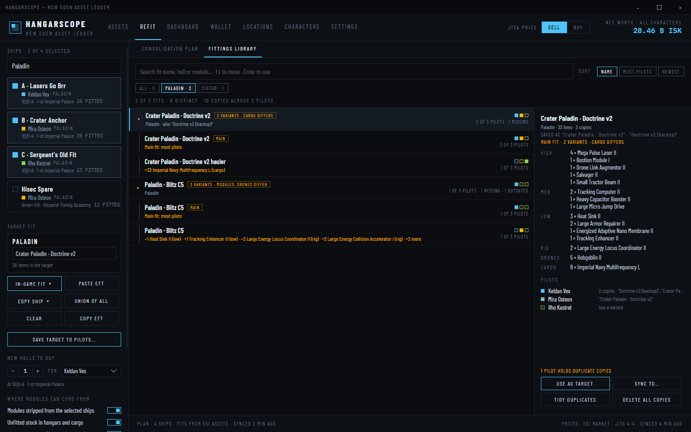
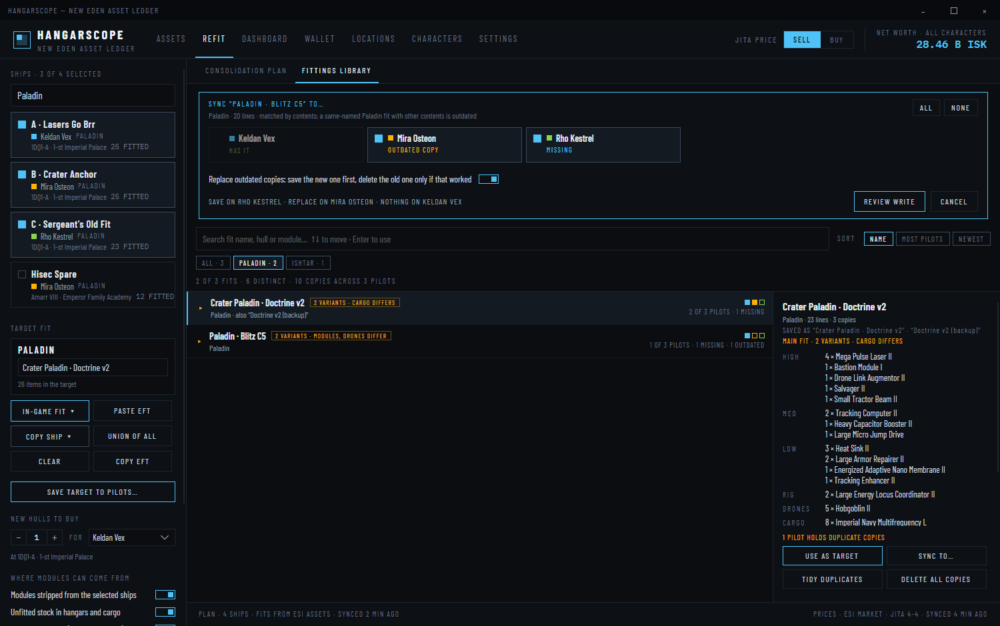
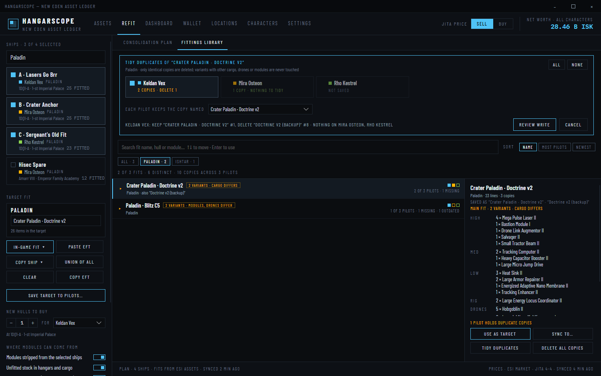

# HANGARSCOPE — New Eden Asset Ledger

A self-hosted Windows desktop application (jEveAssets-style) that aggregates assets across multiple EVE Online characters via ESI, tracks each character's live location, computes jump distances from characters to assets, values everything against Jita market prices, and provides a wallet overview.

Built with **.NET 10 + Avalonia UI** (C#, XAML, MVVM). The UI is a faithful recreation of the high-fidelity design prototype in [`design/`](design/), extended to scale to accounts with many characters.


## Screens

Full feature documentation with screenshots: **[docs/FEATURES.md](docs/FEATURES.md)**.

- **ASSETS** — filterable/sortable asset browser: search, multi-select character chips (value-sorted, scrollable), distance-from selector, region/category/ownership/min-value filters, location tree, virtualized 8-column table with jump-distance coloring.
- **REFIT** — consolidate several ships (on any pilots) onto one fit: per-ship strip/fit work orders with their source (swap, contract, pickup, buy), pickup and shopping lists, new hulls, slot checks, EFT import/export, multibuy export, and a FITTINGS library that syncs saved in-game fits to the pilots you pick and replaces outdated copies. See [REFIT](#refit).
- **DASHBOARD** — total net worth, per-character cards in a value-sorted wrap grid, value-by-region bars (top 12 + OTHERS), top 10 holdings.
- **WALLET** — liquid ISK totals, per-character balances with 30-day delta, 30-day flow by ref-type and by station, accumulated journal (kept locally beyond ESI's 30-day window).
- **LOCATIONS** — live per-character cards: system (security-colored), region, ship, docked status, nearest asset hubs by jumps.
- **CHARACTERS** — EVE SSO (OAuth2 + PKCE) linking, token expiry, per-character sync/unlink.
- **SETTINGS** — user-supplied ESI application credentials (stored DPAPI-encrypted, never leave the machine), price hub/side, sync cadences, citadel name policy, cache purge.

Until a character is linked, the app shows the design's demo dataset so every screen is explorable (`--demo` forces it).

## REFIT


Select the ships to standardise in the rail (filter by hull, ship name or pilot), then set the target: an in-game fit from any pilot (**IN-GAME FIT ▾** opens the fit picker: search by name, hull or module, hull chips, sort, ↑↓ + Enter), pasted EFT, a copy of one ship, or the union of all of them. HangarScope then shows, per ship, what to strip and what to fit, and where every fitted item comes from:

- **SWAP** — stripped from another selected ship of the same pilot (always tried first);
- **CONTRACT** — stripped from another pilot's ship, moved with an item-exchange contract (can be turned off);
- **PICKUP** — unfitted stock in a hangar, container or ship's cargo, with location, owner and jumps;
- **BUY** — what is still missing, priced at the configured hub. New hulls go on the same list.

Rigs are destroyed when removed, so they are never swapped. Loaded charges (crystals, scripts) are never treated as modules. Each slot group is checked against the hull's slot count.


The shopping list copies as an in-game **Multibuy** list; the target copies as EFT. **SAVE TARGET TO PILOTS…** and the **FITTINGS LIBRARY**'s **SYNC TO…** open a pilot picker: each pilot shows whether it has the fit, has an outdated same-named copy, is missing it, or lacks the fittings write scope. Missing pilots start ticked; **ALL** / **NONE** are shortcuts. A ticked outdated pilot gets the new copy saved first, and its old copy is deleted only after that save worked. The FITTINGS LIBRARY uses the same fit picker: identical fits saved under different names or on different pilots are one entry, fits that differ only in cargo or drones (or share a name with other contents) are grouped as expandable variants, and a preview shows the slots and who has it. **TIDY DUPLICATES** deletes a pilot's extra identical copies through the same pilot picker, keeping the name you choose; variants are never touched. The library can also delete fits. Every in-game write waits for an explicit **CONFIRM · WRITE IN GAME** that lists what each pilot gets, and the result is reported per pilot. Plans are saved to `%APPDATA%\HangarScope\refits.json`.








Full details, including the planner's rules: [docs/FEATURES.md](docs/FEATURES.md#refit--consolidate-several-ships-onto-one-fit).

## Getting started

1. Install the [.NET 10 SDK](https://dotnet.microsoft.com/download).
2. `dotnet run --project HangarScope`
3. Register an application at [developers.eveonline.com](https://developers.eveonline.com) with callback URL `http://localhost:8635/sso/callback` and these scopes:
   - `esi-assets.read_assets.v1`
   - `esi-location.read_location.v1`
   - `esi-location.read_ship_type.v1`
   - `esi-universe.read_structures.v1`
   - `esi-wallet.read_character_wallet.v1`
   - `esi-fittings.read_fittings.v1` — reads each character's saved in-game fittings
   - `esi-fittings.write_fittings.v1` — saves or deletes fittings in a character's in-game Fitting window (only on an explicit, confirmed action in REFIT)

   Characters linked before the fittings scopes were added keep working; they show fewer scopes granted in **CHARACTERS** and skip fittings until you authenticate them again.
4. In **SETTINGS**, paste your client ID + secret key, **SAVE CREDENTIALS**, then **TEST CONNECTION**.
5. In **CHARACTERS**, click **AUTHENTICATE VIA EVE SSO** — your browser opens; log in and authorize. Repeat per character.

Assets, prices, locations, wallet and routes then sync on the cadences configured in SETTINGS (respecting ESI cache timers: assets/journal 1 h, location ~5 s).

## Architecture

```
HangarScope/
  Models/        domain types (characters, stations, asset stacks, journal, settings)
  Services/
    EsiClient    ESI HTTP client: ETag caching, X-Pages pagination, error-limit backoff
    SsoService   EVE SSO OAuth2 authorization-code + PKCE, localhost callback listener
    UniverseSvc  type/group/category, station/structure, system/region resolution + cache
    SyncService  orchestrates syncs, aggregates asset stacks, computes routes, builds snapshots
    RefitPlanner pure REFIT planner: strip/fit orders, swaps, contracts, pickups, buys, slot checks
    EftFormat    EFT fitting import/export and multibuy export
    FitSync      pure fitting sync rules: per-pilot state, save-then-delete replacement
    FitCatalog   pure fit picker rules: merging identical fits, variant groups, search ranking, tidy plan
    JsonStore    JSON persistence under %APPDATA%\HangarScope, DPAPI for secrets/tokens
  ViewModels/    MVVM (CommunityToolkit.Mvvm); MainViewModel ports the prototype's logic 1:1
  Views/         seven screens + custom title-bar window, styled to the design tokens
  Controls/      FractionBar (proportional value bars)
HangarScope.Tests/  xUnit tests for the REFIT planner, EFT format, fitting sync, fit catalog and fittings cache rules
```

Tests: `dotnet test HangarScope.slnx` (CI runs every `*.Tests.csproj`).

Storage: everything lives in `%APPDATA%\HangarScope` — settings, encrypted credentials/refresh tokens (Windows DPAPI), and a `cache/` directory (assets, per-ship fits in `ships-{charId}.json`, saved in-game fittings in `fittings-{charId}.json`, prices, routes, universe incl. hull slot counts, accumulated journal) that PURGE CACHE clears. REFIT plans are kept in `refits.json`, outside the cache. Sync events log to `sync.log`, UI timings to `perf.log`.

Performance: the asset table is virtualized and the view model recomputes per-screen sections lazily (search debounced, sync broadcasts coalesced, sort clicks reorder without re-filtering) — the UI stays responsive with tens of thousands of asset items. For fastest startup, publish with ReadyToRun:

```bash
dotnet publish HangarScope -c Release -r win-x64 --self-contained false -o publish
```

## Fonts

Bundled [Barlow Condensed](https://fonts.google.com/specimen/Barlow+Condensed) and [IBM Plex Mono](https://fonts.google.com/specimen/IBM+Plex+Mono), both under the SIL Open Font License (see `HangarScope/Assets/Fonts/`).

## License

MIT. EVE Online and all related assets are property of CCP hf. This is a third-party tool using the public ESI API.
