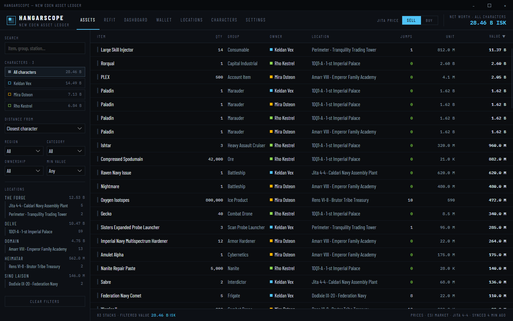
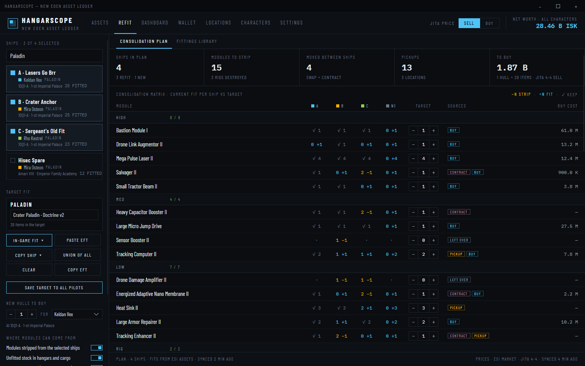
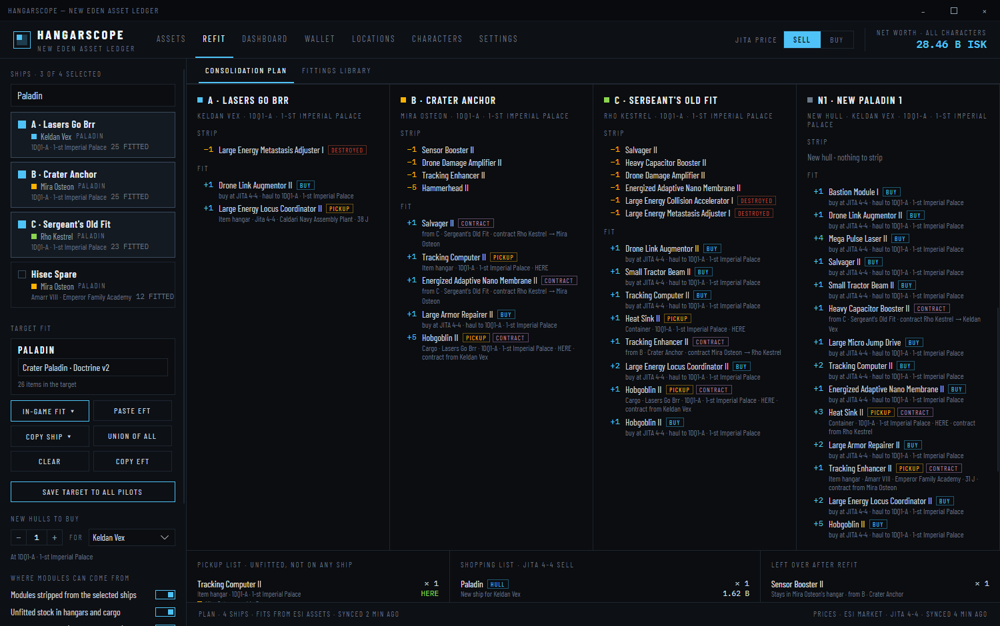
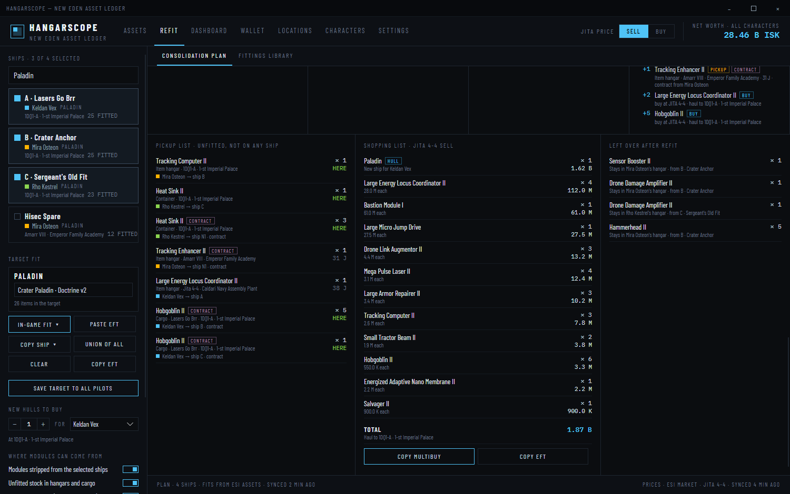
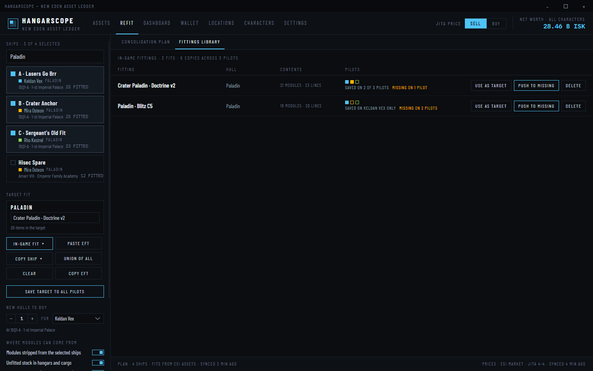
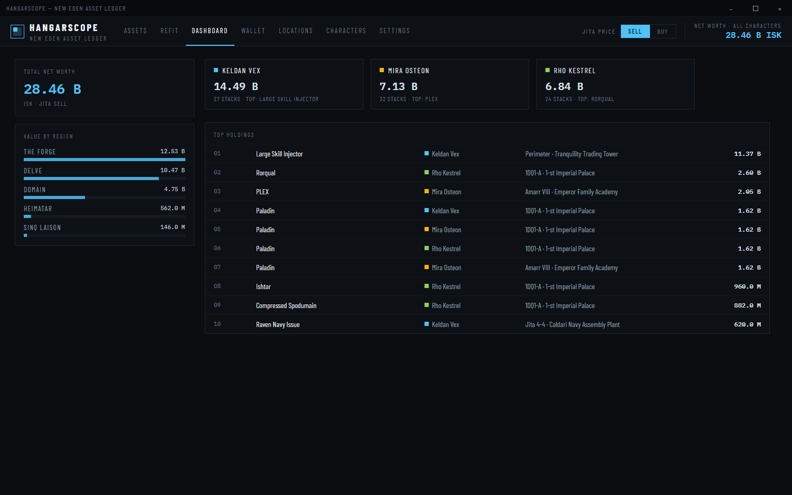
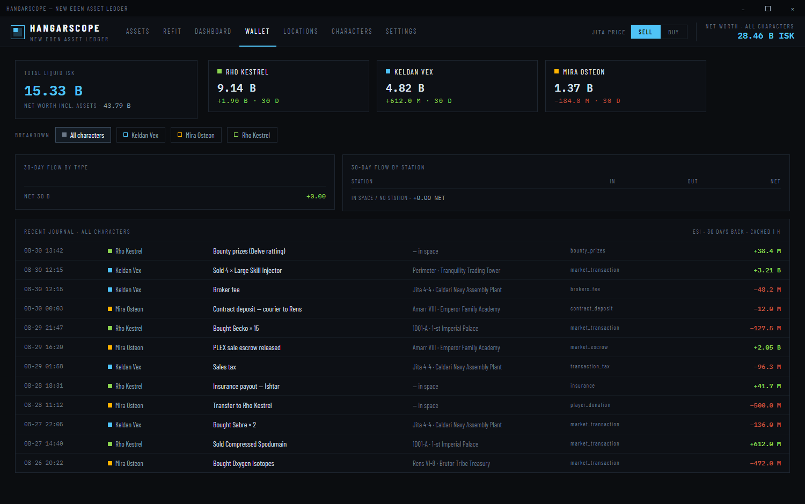
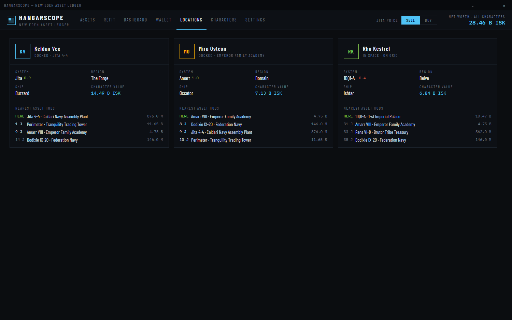
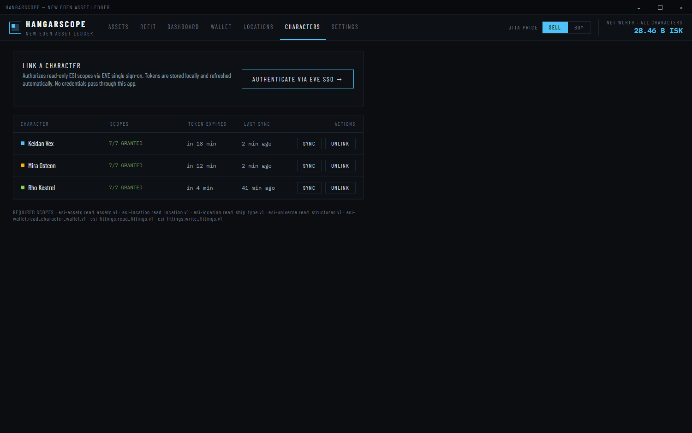
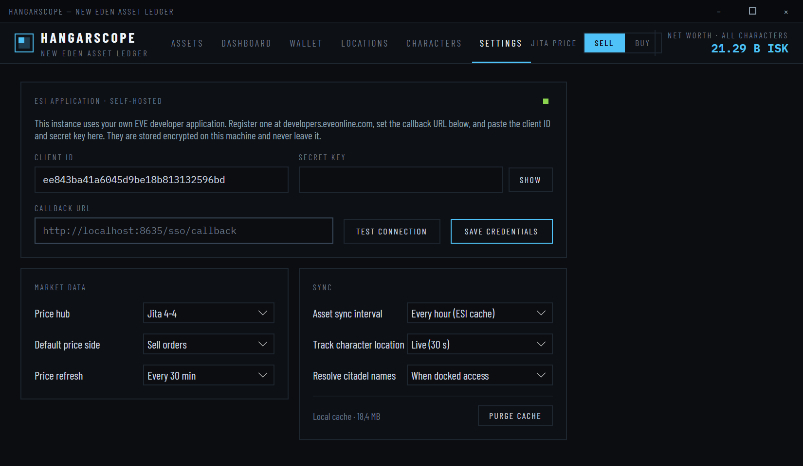

# HANGARSCOPE — Feature Guide

All screenshots show the built-in demo dataset (`HangarScope.exe --demo`). With linked characters every number, station, and jump count comes live from ESI. The code lives in [`HangarScope/`](../HangarScope) — each screen is a view in [`Views/`](../HangarScope/Views) backed by the sectioned recompute engine in [`ViewModels/MainViewModel.cs`](../HangarScope/ViewModels/MainViewModel.cs); all ESI I/O is in [`Services/`](../HangarScope/Services).

## ASSETS — the asset browser

The main ledger: every asset stack across every linked character, aggregated by type + station + ownership flag.

- **Search** matches item name, group, and station text (debounced, precomputed lowercase blobs — fast at thousands of stacks).
- **Characters** — additive multi-select chips, sorted by asset value, with per-character totals. Empty selection = all. Scrolls beyond ~8 characters, header shows the count.
- **Distance from** — jump counts computed from the *closest selected character* or a specific one. Route lengths come from ESI `/route/` and are cached per system pair.
- **Filters** — region, category (Ships/Modules/Minerals/…), ownership (Hangar / Fitted / In container), minimum stack value. All filters AND together.
- **Locations tree** — regions with totals, stations with stack counts; clicking a station toggles it as a filter.
- **Table** — sortable by ITEM / QTY / JUMPS / VALUE. Jump counts are color-coded (green = here, red = >10 jumps). `FITTED` / `CTNR` chips mark non-hangar stacks. Virtualized — real characters with thousands of stacks scroll smoothly.
- **Footer** — filtered stack count and value, plus price-sync provenance (hub + age).
- The `SELL`/`BUY` toggle in the header re-values everything instantly against Jita sell or buy orders.

## REFIT — consolidate several ships onto one fit

Pick the ships you want to standardise, set one target fit, and REFIT works out for every hull what to **strip**, what to **move across** from the other ships, what is **sitting unfitted somewhere** and needs picking up, and what is left to **buy** — including brand-new hulls. The tab sits between ASSETS and DASHBOARD.

**Rail**

- **Ships** — every assembled ship across all pilots, filtered by hull, ship name or pilot. Click to add a ship to the plan; selected ships get column keys A, B, C… The list is virtualized.
- **Target fit** — **IN-GAME FIT ▾** picks any fitting saved in game by any pilot, **PASTE EFT** imports the in-game "Copy to clipboard" format (unknown names are resolved with `POST /universe/ids/`), **COPY SHIP ▾** copies one selected ship, **UNION OF ALL** takes the most of every module across the selected ships, **CLEAR** starts over, **COPY EFT** exports the target. The fit name is editable.
- **Save target to all pilots** — saves the target as an in-game fitting on every pilot who does not already have it (matched by hull + modules, ignoring the name). Nothing is written until you press **CONFIRM · WRITE IN GAME** in the confirmation bar.
- **New hulls to buy** — a stepper and a pilot. New hulls are empty ships filled last; the hull goes on the shopping list.
- **Where modules can come from** — modules stripped from the selected ships; unfitted stock in hangars, containers and cargo; other pilots' items (needs a contract — turn it off to buy instead).
- **Target includes** — drone/fighter bays (on by default), charges (crystals, scripts, ammo — off by default), other cargo (off by default).
- **Saved plans** — name and save the current plan; load or delete saved ones. Plans and the screen's last state live in `%APPDATA%\HangarScope\refits.json`.

**Consolidation matrix** — one row per module, one column per ship (current qty, `−n` to strip in amber, `+n` to fit in cyan, `✓` to keep), a **TARGET** stepper per row that replans instantly, the sources each row uses (SWAP · CONTRACT · PICKUP · BUY · DESTROYED · LEFT OVER) and the buy cost. Slot-group headers check the target against the hull's slots (dogma attributes 14/13/12/1137/1367 from `/universe/types/{id}/`, cached in `universe.json`): green when full, amber with the number of empty slots, red when over. CPU and powergrid are not checked.

**Work orders** — one card per ship: what to strip (rigs marked DESTROYED) and what to fit, each line with its source — the ship it comes from, the container and station for pickups (with jumps or HERE), the contract direction between pilots, or "buy at JITA 4-4 · haul to …".

**Pickup list · shopping list · left over** — every unfitted stack the plan uses (location, owner, destination ship, contract flag, jumps); the shopping list priced at the configured hub and side, with the new hulls first, a total, **COPY MULTIBUY** (paste into the in-game Multibuy window) and **COPY EFT**; and what is left over after the refit, by owner.

### How the planner decides

Implemented in [`Services/RefitPlanner.cs`](../HangarScope/Services/RefitPlanner.cs) as one pure function, covered by [`HangarScope.Tests`](../HangarScope.Tests).

- **Fitted means in use.** A module fitted to a ship that is not in the plan is never offered.
- **Unfitted means available.** Hangar stacks, containers and ship cargo (any ship's) are stock, always marked PICKUP with location, owner and jumps.
- **Swap first.** Modules stripped from one selected ship fill gaps on the others before any stock is touched — same pilot first.
- **Different pilot, needs a contract.** Moving an item between characters is marked CONTRACT (from-pilot → to-pilot); a pickup owned by another pilot is flagged too. With the contracts toggle off, those items are bought instead.
- **Rigs are destroyed** when removed: they are never swapped and never counted as left over.
- **Charges are not modules.** Loaded crystals and scripts sit under `HiSlot`/`MedSlot` flags in ESI data; anything in the Charge category is grouped as CHARGES, never as a stray module, and never counts against slots.
- **Nearest stock first**, then stock owned by the ship's own pilot, then the biggest stack.
- **New hulls are filled last**, after every existing ship.

## FITTINGS library

REFIT → **FITTINGS LIBRARY** merges every pilot's saved in-game fittings. Identical fits on several pilots (same hull and modules, any name) are one row, with a dot per pilot (filled = has it) and how many are missing it.

- **USE AS TARGET** loads the fit into the plan.
- **PUSH TO MISSING** saves the fit on the pilots who don't have it.
- **DELETE** removes every copy of the fit from the game.

Push and delete only run after the confirmation bar's **CONFIRM · WRITE IN GAME**. ESI cannot edit a saved fit in place, so a changed fit is saved as a new copy. ESI caches each character's fittings list for about five minutes; HangarScope keeps its local copy after a save or delete until ESI serves a list generated after the write, so a deleted fit no longer reappears and a new one no longer vanishes on the next sync.

## DASHBOARD — net worth

- Total net worth (assets, at the chosen price hub and side).
- One card per character — value, stack count, top holding — in a wrap grid sorted by value, built for accounts with many characters.
- Value by region bars (top 12 + aggregated OTHERS).
- Top 10 holdings across all characters with owner and location.

## WALLET

- Total liquid ISK + combined net worth including assets.
- Per-character balance cards with a signed 30-day delta (green/red).
- **Breakdown** chips filter every panel below to one character.
- **30-day flow by type** — signed bars per aggregated ref_type (bounties, market sells/buys, fees + tax, contracts, escrow, insurance, transfers…), with the 30-day net below.
- **30-day flow by station** — IN / OUT / NET per station, sorted by |net|, plus an "in space / no station" line for station-less entries.
- **Recent journal** — date, owner, description, station, ref_type, signed amount. Market transactions are enriched from `/wallet/transactions/` ("Sold Large Skill Injector × 4" instead of a generic label). The journal accumulates locally forever — ESI only serves 30 days back.

## LOCATIONS — character tracker

One card per character:

- Live status (DOCKED · station / IN SPACE · ON GRID), refreshed on the configured cadence (down to 30 s).
- System with security-status coloring (≥0.5 green, >0 amber, ≤0 red — wormholes show −1.0 red), region, current ship, character asset value.
- **Nearest asset hubs** — stations holding assets sorted by jump distance from that character; `HERE` in green at 0 jumps, `—` where no gate route exists.

## CHARACTERS — EVE SSO

- **Authenticate via EVE SSO** launches the OAuth2 authorization-code + PKCE flow in your browser against your own ESI application; the local callback listener captures the code. Repeat once per character — any number of characters can be linked.
- The table shows granted scopes, access-token expiry countdown, and last sync per character, with per-character SYNC and UNLINK actions.
- Refresh tokens are stored DPAPI-encrypted and rotated automatically.

## SETTINGS

- **ESI application** — your client ID and secret key (stored encrypted, never leaving the machine), the fixed callback URL to register at developers.eveonline.com, TEST CONNECTION, and a credentials-verified indicator.
- **Market data** — price hub (Jita 4-4 / Amarr / Dodixie / Rens), default price side, refresh cadence.
- **Sync** — asset sync interval (ESI caches assets 1 h), location tracking cadence, citadel name resolution policy, cache size + PURGE CACHE.

## Under the hood

- **ESI client** — ETag caching, `X-Pages` pagination, error-limit backoff, ≤8 concurrent requests.
- **Asset aggregation** — raw asset items are walked up their container/ship chains to a root station or structure; fitting-slot flags become FITTED, nested items CTNR.
- **Ship fits** — alongside the per-station stacks, every assembled ship is kept with its own contents (slot flag, type, qty) and its player-given name (`/assets/names/`). This is what lets HangarScope tell which module is on which hull.
- **Saved fittings** — with the fittings scopes granted, each character's in-game saved fittings are synced, and a fitting can be saved to several characters at once. Fits are matched across characters by hull and module list, ignoring the name. A sync right after a save or delete keeps the local list while ESI still serves its cached copy from before the write.
- **Hull slots** — slot counts per hull come from the type's dogma attributes and are cached with the type in `universe.json`.
- **Prices** — per-type regional order books; best sell at the hub station, best regional buy.
- **Diagnostics** — sync events log to `%APPDATA%\HangarScope\sync.log`, UI timings to `perf.log`.
- **Demo mode** — `--demo` forces the prototype dataset (it includes four fitted Paladins, saved fittings and spare modules for REFIT). Screenshot automation flags: `--screen=<assets|refit|dash|wallet|loc|auth|settings>` opens on a given tab, `--refit-mode=fittings` opens the FITTINGS library, `--refit-scroll=<orders|lists>` scrolls the plan, and `--snapshot=<file.png>` renders the window to a PNG and exits.
