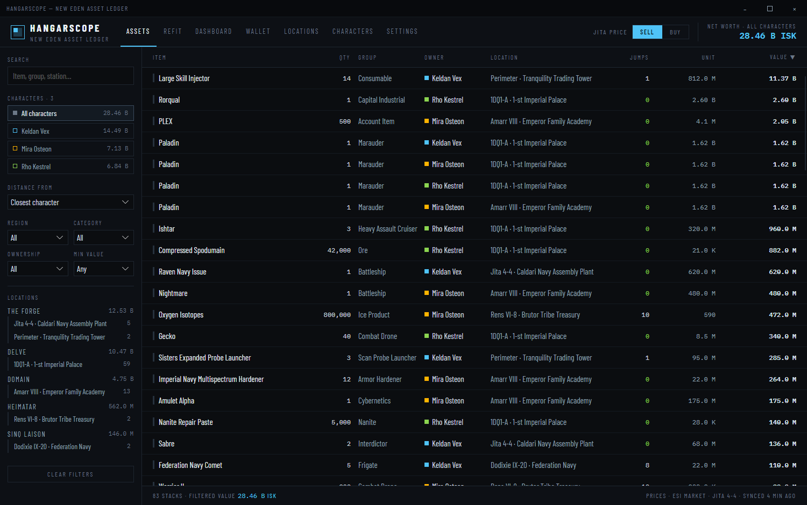
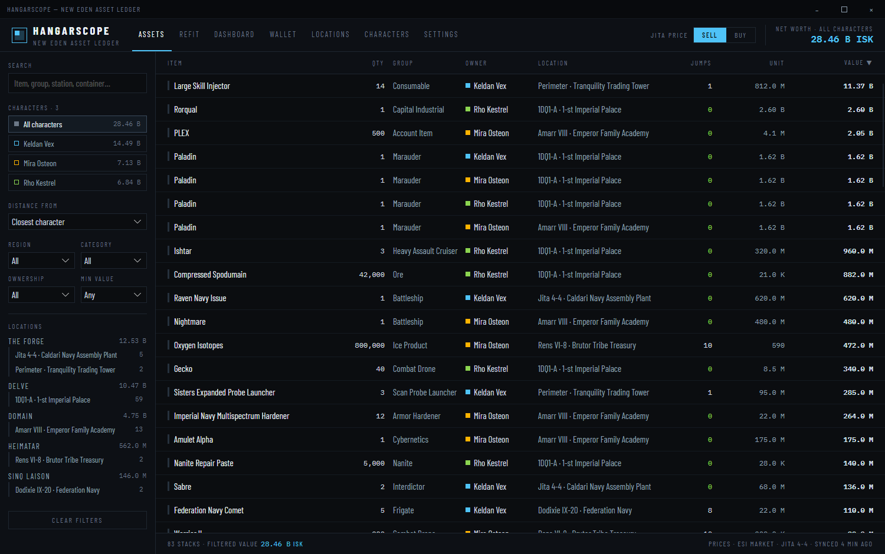
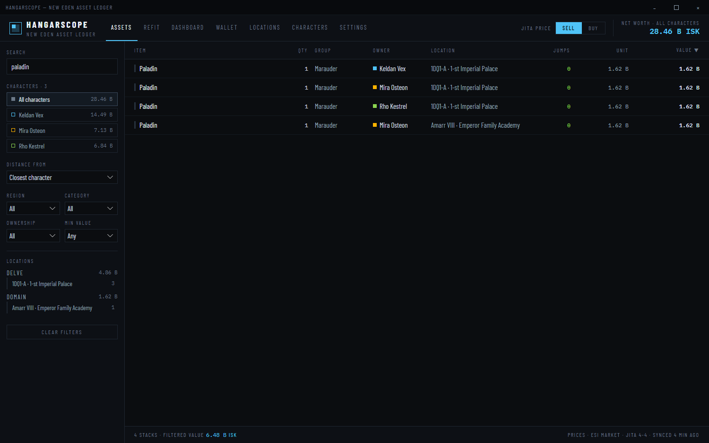
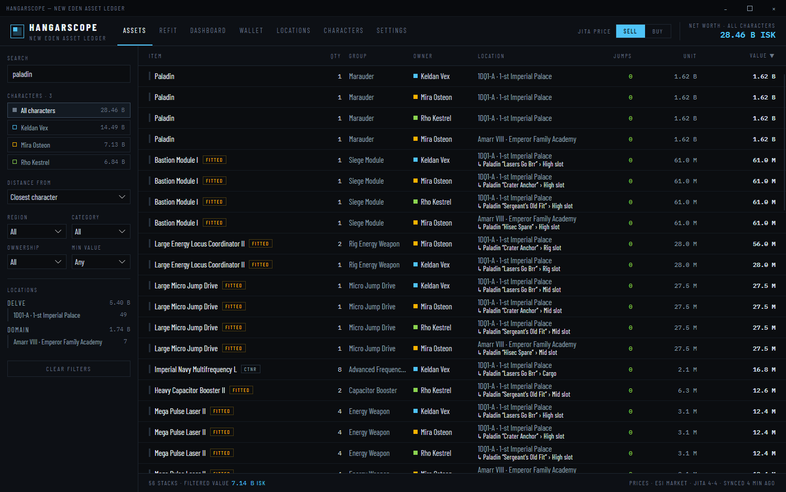

# Show which container or ship holds an item

**Date:** 2026-11-11

## Description

Items inside a container or a ship only said `CTNR` or `FITTED` next to the station, so with several containers or
ships at one station there was no way to tell which one held them. The ASSETS table now shows the exact container
and ship chain under the station, for example `↳ Paladin “Lasers Go Brr” › Cargo` or
`↳ Rorqual › Fleet hangar › Small Secure Container “Ammo”`, and search matches container and ship names.

## Before / After

| Before | After |
| --- | --- |
|  |  |
|  |  |

## Change

- New pure `Services/AssetLocator.cs`: walks each ESI asset up its container/ship chain (as the sync loop did
  before), and describes the chain outermost first: the holder's type and player-given name, then the bay or slot
  (`High slot`, `Cargo`, `Drone bay`, `Fleet hangar`, `Ore hold`…). Plain container flags (`Unlocked`, `Locked`) add
  nothing. Cycles and depth are guarded as before.
- `SyncService`: uses `AssetLocator`; stacks are now keyed by type, station, ownership **and path**, so the same item
  in two containers is two rows. Player-given names are fetched once for every container and ship
  (`POST /characters/{id}/assets/names/`, already used for ship names) and shared with the REFIT ship list.
- `AssetStack.Path` (and the cached `cache/assets-<id>.json` stacks) carry the path; caches written by older versions
  have no path until the next asset sync.
- ASSETS table: the LOCATION cell shows the path on a second line with a tooltip of the full location; the search box
  matches it (placeholder "Item, group, station, container…").
- Demo data: container and fitted stacks have realistic paths. `--assets-search=<text>` pre-fills the ASSETS search
  for screenshot automation.
- ESI: no new endpoints or scopes. Tests: `HangarScope.Tests/AssetLocatorTests.cs`. Not tested against a live
  character's ESI data in this change; the demo dataset and unit tests cover the paths.
