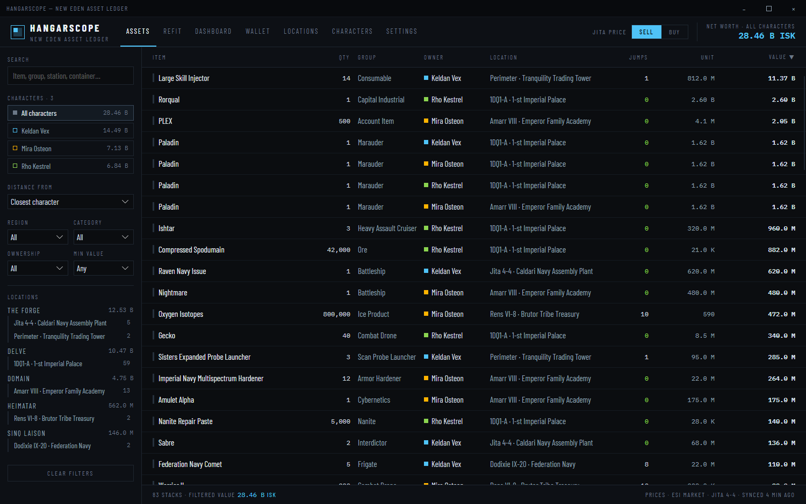
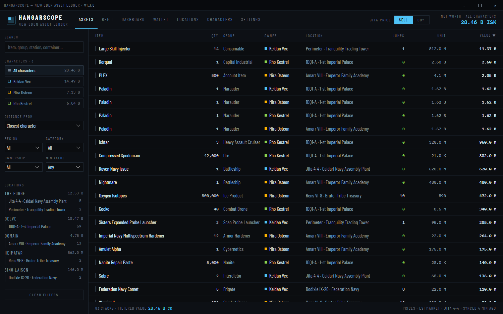

# Show the app version

**Date:** 2026-11-11

## Description

Nothing in the app said which version was running. The title bar now shows it after the app name, for example
`HANGARSCOPE — NEW EDEN ASSET LEDGER · V1.3.0`, so you can check that an auto-update has been applied.

## Before / After

| Before | After (release build) | After (local build) |
| --- | --- | --- |
|  |  |  |

`after-release.png` is a local build made with `-p:Version=1.3.0`, as CI builds releases.

## Change

- New pure `Services/AppVersion.cs`: formats the assembly's informational version for display (`1.3.0+sha` →
  `V1.3.0`, CI builds `0.0.1-ci.N` → `V0.0.1-CI.N`, `0.0.0-dev` or missing → `DEV BUILD`).
- `Views/MainWindow.axaml`: the title bar shows `AppVersion.Display` after the app name.
- `HangarScope.csproj`: the local-build default `<Version>` changes from `1.2.0` (stale) to `0.0.0-dev`. Releases are
  unaffected: the shared build workflow always passes `-p:Version`.
- Tests: `HangarScope.Tests/AppVersionTests.cs`. No new settings, files, ESI endpoints or scopes.
- `docs/screenshots/` are not refreshed: only the title bar changes, and local captures show `DEV BUILD`.
